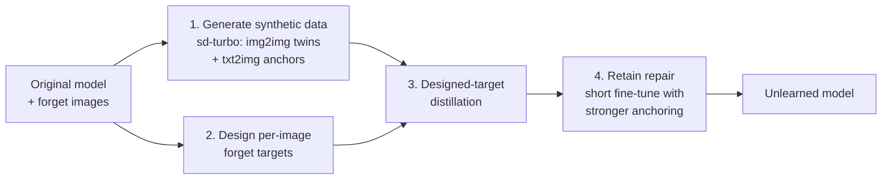

# CISPA2
Repository for the CISPA European AI Championship second edition on watermarking for Automateam2

# Watermark localisation: team automateam2

**Best submission: `submission_v19b_sam.pt`, public score 0.7324** (submission 4223). The expected CV on train was 0.7332.

Each image is watermarked by **PixelSeal, TrustMark or StegaStamp** on a sub-region and then edited (outpainting,
object removal, addition or transplant). The method and the 100/256-bit message are known, on the test set too.
We predict a 128×128 binary mask, and the metric is the per-image 2-class mIoU.

Two main ideas carry the score:
- **Use the official watermark decoder as a feature extractor.** It knows what this watermark looks like and can
  check the known message.
- **Fuse many diverse localisation maps, then correct the shapes.** Detected rectangles must decode the message;
  objects are snapped to SAM segments.

## Locations

| Alias | Path | Content |
|---|---|---|
| `W/` | `/p/project1/training2666/debbah2/wmloc_unet/` | Main code, maps, runs, submissions. Full write-up in `W/BILAN_ARCHI.md` (French), experiment log in `W/COORD.md` |
| `loc/` | `Hackathon_Watermark_Localisation_Task/loc/` (this repository) | Data helpers, rectangle search, SAM candidates and snapping, cached decoder outputs (`loc/cache/`) |
| data | `Hackathon_Watermark_Localisation_Task/release/{train,test}` | 510 train images (170 per method), 1020 test images |
| models | `Hackathon_Watermark_Localisation_Task/starter_kit/models` | Official decoders |

Python: `Hackathon_Watermark_Localisation_Task/.venv/bin/python` (torch, timm, scipy, onnxruntime).

## Key observations
- **Two regimes.**
  - Type **T** (`full_watermark`): about 90 % of the image is watermarked, and the task is to find the *holes*.
  - Type **F**: about 9 % is watermarked, as a rectangle from outpainting (F-rect) or an object (F-seg).
  - The global signed confidence of the decoder, `g = mean(logits × (2·msg − 1))`, separates T from F with an AUC
    of about 0.999. See `W/stack/v3.py:g_of` and `loc/common.py:signed_conf`.
- **Sliding-window or crop decoding carries almost no signal:** the decoder needs context.
  Learned maps built on the decoder's *features* work far better.
- **For F-rect images, cropping exactly the right box and resizing it the way the official wrapper does makes the
  decoder read the message back** (bit acc ≈ 1). The rectangle can therefore be *verified*, not just guessed.

## Pipeline (v19b) and code pointers

### 1. Source maps (128×128 logits; out-of-fold on train, 5 folds; test = mean of the fold models)

**1a. wm-U-Net: the strongest single source, about 0.61 alone.** Its encoder is a copy of the official decoder.
- Code: `W/stack/wm_unet.py`.
  - `WMUNet` (l.43): PixelSeal ConvNeXt at 256 px, TrustMark ResNet-50 at 245 px.
  - `StegaUNet` (l.84): an exact PyTorch port of the StegaStamp ONNX decoder, STN included, in `W/stack/stega_torch.py:StegaDecoder`.
    It predicts in the STN-warped frame and maps the result back to the image grid with the inverse affine.
- Bottleneck: the decoder's per-position message-agreement map plus `g`. Skips come from the decoder stages,
  plus a full-resolution high-pass stem.
- Training:
  1. Pre-training on synthetic edits (`SynthStream`, generator `W/synth/generator.py`).
  2. 5-fold fine-tuning on the real images.
- Loss: BCE + soft mIoU (`W/unet.py:miou_loss`).
- Outputs in `W/stack/maps/<tag>_{train,test}_<method>.npz`, tags `wmunet*`.

**1b. "Stack" U-Nets on generic ImageNet encoders: the encoder zoo, the last big gain.**
- Code: `W/train_unet.py`, model `W/unet.py:UNet128`.
- Inputs: RGB + high-pass ×20, plus a global vector (method one-hot, `g`, bit acc) injected at the bottleneck.
  The decoder also receives stacked auxiliary maps (head logit, per-position detector confidence, heatmap).
- 5-fold training, dihedral TTA (`predict`, l.131). The architectures are listed in `VARIANTS` (l.32).
- Encoders in v19b:
  - EfficientNet-B3, EfficientNetV2-S, ResNet-50, RegNetY-032;
  - **zoo added on the last day:** `zhrw18` (HRNet-W18, the best, about 0.61 alone), `zregy040`, `zrx50`, `zr2n50`, `zeffb4`.
- Job scripts: `W/run_zoo_{A,B}.sh`. The folds run in parallel, about 16 min on 2 nodes.
  `W/merge_zoo.py` builds `runs/<v>/{oof_all,test_mean}.npz`.

**1c. Heads on frozen decoder features.**
- `W/stack/head_maps.py`: per-position logistic regression.
- `W/stack/head_multi.py`: multi-layer hypercolumns.
- `W/stack/head_synth*.py`: convolutional heads trained on synthetic data.
- `W/stack/remark_maps.py`: StegaStamp re-marking residual.

### 2. Fusion, threshold rule, post-processing: `W/stack/v3.py`
- **Fusion.** Per-cell logistic regression on `[clip(logit_s, ±8), g/5, g/5·logit_s]`
  (`fuse_feats` l.94, `fit_fusion` l.99, `oof_fusion` l.108). The candidates are single sources, top-2, top-3 and all;
  the one with the best CV wins.
- **Threshold rule.** The rule is chosen per method by CV; `emiou_none` wins for all 3 methods.
  - `emiou_none` (`W/stack/rule_emiou.py:emiou_rule` l.74, `rule_preds_plus` l.108): for each image, keep the top-k
    cells, with k chosen to maximise the *expected* soft mIoU under the fused probabilities. It has no fitted parameter.
- **Post-processing by predicted type.** `POST_T` / `POST_F` (l.210-214) fill small holes or drop small blobs.
  The choice is made by CV (`post_scores`, `cv_select`).

### 3. Decoder-verified rectangles (F-rect)
- **Search.** A grid search plus greedy refinement of boxes, scored by decoding the crop resized like the official
  wrapper: StegaStamp 400 bicubic, PixelSeal 256 bilinear, TrustMark 245.
  - `loc/rect_search.py` (`coarse_boxes`, `refine`).
  - `loc/ss_local_search.py`: local search for StegaStamp around the predicted blob.
  - `W/stack/rect_seeded.py`: seeds taken from the fused map.
- **Use.** If the best box decodes the message with bit acc ≥ a threshold chosen by CV (0.85 / 0.85 / 0.9),
  the mask becomes that box: `v3.py:load_rect` l.42, option `--rect`.

### 4. SAM snapping (F-seg)
- **Candidates.** About 100 SAM ViT-L segments per image, precomputed in `loc/gen_candidates.py` → `loc/cache/sam_cands/`.
- **Rule.** For F images without a rectangle, take the segment that maximises soft IoU with the map × inside/outside
  contrast. Replace the mask only above a score threshold chosen by CV: `W/stack/snap_sam_local.py:snap` (l.71),
  a copy of `loc/snap_sam.py`.
- **Driver.** `W/stack/sam_stage.py <submission.pt>` replays the version from its `.json`, checks CV and test masks,
  snaps, and keeps `<stem>_sam.pt` only if the CV improves. It adds about +0.02 to +0.024 CV.

## Reproducing v19b
```bash
PY=/p/scratch/training2666/ayadi1/automateam2/Hackathon_Watermark_Localisation_Task/.venv/bin/python
cd /p/project1/training2666/debbah2/wmloc_unet/stack
E="headmulti remark headsyn headsyn2 wmunet wmunet0 wmunetF wmunetF0 wmunetH wmunetH0 wmunet2 wmunet20"
R="effb3_hp_glob effb3_hp_glob_stack rgb_hp_glob_synth8k loc_effv2s_hp_glob_stack loc_r50_hp_glob_stack loc_regy032_hp_glob_stack \
   zregy040_hp_glob_stack zrx50_hp_glob_stack zr2n50_hp_glob_stack zhrw18_hp_glob_stack zeffb4_hp_glob_stack"
WMLOC_NO_RECT3=1 $PY v3.py --rect --rules_plus --runs $R --extras $E --out ../submissions/submission_v19b.pt --baseline_cv 9   # CPU, ~3 min
$PY sam_stage.py ../submissions/submission_v19b.pt                                                                          # CPU, ~2 min
```
Upload: `from submission_template import submit; submit(path)`, run from `starter_kit/`.
Never run `submission_template.py` as a script: it uploads automatically.

## Score progression (public leaderboard)

| Version | Main addition | Public score |
|---|---|---|
| v1 | Logistic heads + T/F switch rule | 0.567 |
| v3c | Fusion + decoder-verified rectangles | 0.663 |
| v4_wmunet | wm-U-Net (decoder as encoder) | 0.687 |
| v7_sam | Seeded rectangles + SAM snapping | 0.709 |
| v9_sam | Expected-mIoU threshold rule | 0.713 |
| v12a_sam | Stack U-Nets with other encoders (EffV2-S, R50, RegNetY) | 0.719 |
| **v19b_sam** | **Encoder zoo (HRNet-W18, RegNetY-040, ResNeXt50, Res2Net50, EffB4)** | **0.7324** |

## What did not help (details in `W/BILAN_ARCHI.md` §8 and `W/COORD.md`)
- Sliding-window or crop decoding, gradient attribution, re-marking (except a little on StegaStamp).
- Shape families with learned selection, a learned SAM-segment choice, decoding each SAM segment.
- Test pseudo-labels, VAE reconstruction maps, position priors, smoothing the fused map.
- Paper-inspired modules, each tested with a paired control:
  - attention blocks in the wm-U-Net;
  - a WAM-style per-cell bit-decoding head (`W/stack/wam_ft.py`; the bit loss stays at chance with 136 images per fold);
  - MELB block statistics (`W/stack/melb_blocks.py`);
  - EditGuard's degradation prompts, not built: train and test show no degradation shift, since all are PNG with
    matched noise and blockiness statistics.
- **Lesson:** architecture *diversity* of the fused U-Nets helped most. Add-on modules on one network did not.


# Designed-Target Distillation for Machine Unlearning

Our solution to the **Unlearning** task of the European AI Championship (Paris 2026).

We start from a ViT-B/16 classifier trained on a 100-class dataset. The goal is to make it behave **as if it had never seen 3,500 specific training images**, while leaving its behaviour on everything else unchanged.

Our method has two ingredients:

1. **Designed-Target Distillation.** For every forget image, we write down the output we want the model to produce. Then we distil the model toward these targets.
2. **Synthetic anchors from a diffusion model.** We generate new in-distribution images with a diffusion model. These images keep the rest of the model's behaviour intact while it forgets, even though no retain data was provided.

**Result:** 0.400 on the public leaderboard. A model that has not unlearned anything scores 0.

---

## The problem in one paragraph

The scoring does not reward simply destroying accuracy on the forget images. It compares the model with a **"gold" reference**: the average of several models retrained from scratch without those images. A good submission must match gold:

- in its **loss distribution** on the forget images (mean and spread),
- in its **predicted class distribution, image by image**, including which wrong classes it leans toward,
- on the exact images **and** on hidden altered copies of them.

At the same time, the model's outputs on a hidden control set must stay close to the original model's. Even small drift is penalised. We receive no retain data, only the original model and the 3,500 forget images (without labels).

## Motivation

### 1. Unlearning means producing a specific behaviour, not causing damage

A retrained model has never seen a forget image, so it treats it like any new image. On most of them it is moderately unsure. On a minority it is confidently wrong. When it errs, it picks classes that are visually close.

Gradient ascent and similar methods only push the true-class probability down. The result does not look like a model that never saw the data.

So we flip the problem around. **We first decide what the unlearned model should output on each forget image, and then train the model to produce exactly that.** The training objective becomes plain distillation toward known targets, which is stable, controllable and easy to monitor.

### 2. We can generate new images from the same distribution

Looking at the forget set, we noticed that **the images are themselves diffusion-generated**: a consistent cinematic style, shallow depth of field and warm lighting. This means an off-the-shelf diffusion model ([`stabilityai/sd-turbo`](https://huggingface.co/stabilityai/sd-turbo)) can produce **new images from essentially the same distribution**. The original model has never trained on these images.

This addresses the hardest constraint of the task, the lack of any retain data:

| Synthetic data | How it is made | Why we need it |
|---|---|---|
| **Image-to-image "twins"** | Each forget image is lightly re-generated: same object, same style, new pixels | They show how the original model behaves on a near-copy it has *not* memorised. They also anchor the model in the neighbourhood of the forget set, where forgetting is most likely to leak. |
| **Text-to-image anchors** (~20k images) | Generated from a broad vocabulary of objects and scenes (~300 nouns × 6 style prompts) in the dataset's style | The forget set covers only 45 of the 100 classes, but the control set covers all 100. These images give us a stand-in retain set that reaches every class, labelled with the original model's own soft predictions. |

During training we keep the model's outputs on these images close to the original model's (knowledge distillation at temperature 2). In practice this keeps the model unchanged everywhere except on what it must forget.

---

## Method



### Step 1: Generate synthetic data

- **Twins:** sd-turbo image-to-image on every forget image, at several noise strengths. The strength sets how far each twin drifts from its source.
- **Text-to-image anchors:** about 20k images from about 300 object and scene prompts combined with "cinematic photograph" style prompts.
- We run the original model on all generated images and store its logits. These logits are the teacher signal for the retain loss.

### Step 2: Design the forget targets

The forget set has no labels, so we use the original model's prediction as the label. The model has memorised these images, so its prediction is the training label.

For each forget image *i* we build a target distribution (at temperature 2):

```
q_i = [ t_i on the true class ,  (1 − t_i) spread over the other classes ]
```

- **How mass is spread over wrong classes.** We follow the original model's own ranking of the wrong classes (its "dark knowledge"), slightly sharpened. The model then errs toward visually similar classes, as a retrained model would.
- **True-class probability `t_i`.** We optimise it jointly over all images so that the resulting cross-entropy losses follow the distribution we expect from a retrained model:
  - a **heavy-tailed** loss distribution (mean ≈ 5, standard deviation ≈ 7),
  - most images moderately uncertain, a minority confidently misclassified,
  - an average true-class probability around 0.3.
- **Which images get the heavy tail.** We assign this at random. The gold reference averages several independently retrained models, and each of them is wrong on *different* images. So no individual image should be singled out as "the one to forget hardest".

### Step 3: Designed-target distillation

We fine-tune transformer blocks 4–11 and the classification head. Blocks 0–3 and the patch embedding stay frozen. The objective has a **forget** part and a **retain** part.

**Forget (clean and augmented views of each forget image):**
- a KL loss toward the designed distribution `q_i` at temperature 2, and
- a Huber loss on the logit margin, so that each image reaches its designed loss value.

**Retain:**
- KL(original ‖ model) at temperature 2 on a mixed batch of anchors: text-to-image images, image-to-image twins, a few generic outside images, and mixups of forget images.

Settings: 30 epochs, learning rate 2e-4, retain weight 5.

### Step 4: Retain repair

The model already forgets well after Step 3, but it has drifted somewhat from the original on unrelated images. Since drift is penalised in every scored image, **reducing it is the biggest remaining lever**. We therefore run a short second fine-tune from the Step 3 checkpoint. It keeps the same forget targets, and tightens the anchoring:

- a **stronger retain weight** (10) and a larger share of text-to-image anchors (35%),
- **twins closer to the forget images**, plus generated images on which the original model is as confident as on its training data (these behave like the hidden control set),
- **augmented forget views keep their designed loss.** Their target mixes in the original model's prediction on an equally augmented twin, so the model also behaves like gold on altered copies.

Settings: 10 epochs, learning rate 1e-4.

Our final submission is a uniform weight average of two runs of this recipe. This brings a marginal, within-noise gain.

---

## Results (public leaderboard)

| Stage | Score |
|---|---|
| Original model (no unlearning) | 0.000 |
| Designed-target distillation (Steps 2–3, no text-to-image anchors) | 0.385 |
| + text-to-image anchors from the start | 0.397 |
| + retain repair (Step 4) | 0.400 |
| Weight average of two repaired runs (**submitted**) | 0.400 |

Run-to-run noise on the public split is about ±0.005, so the last row only confirms the recipe is stable.

## Key takeaways

- **Define the target behaviour explicitly.** Treat unlearning as distillation toward designed targets, not as gradient ascent. This gives direct control over both the loss distribution and the per-image predictions.
- **Retain drift is the dominant cost.** Every gain in forgetting must be paid for with as little drift as possible. Most of our late improvements came from better anchoring, not from better forget targets.
- **Diffusion models can stand in for missing data.** When the training data is itself synthetic, a generative model can produce in-distribution images the original model has never seen. These images serve both as unseen look-alikes of the forget set and as a retain set covering every class.
- **Keep updates smooth.** Plain full fine-tuning with distillation behaved far better on the hidden evaluation than sharp, localised weight edits.

---

## Repository layout

```
task_template.py          model builder + server preprocessing (provided)
submission.py             submission client (provided)
scripts/
  common.py               shared loading / evaluation utilities
  gen_twins.py            Step 1: img2img twins of the forget images (sd-turbo)
  gen_t2i.py              Step 1: txt2img retain anchors (sd-turbo)
  design_targets.py       Step 2: per-image designed forget targets
  dz.py                   Step 3: designed-target distillation (base)
  dzt.py                  Step 3: + text-to-image anchors
  dzmt.py                 Step 4: retain repair
  soupN.py                weight averaging of checkpoints
```

## Reproducing

Requirements: PyTorch, timm, numpy, and `diffusers` + `transformers` for the generation step. We ran everything on single A100 GPUs.

```bash
# 1. Synthetic data (each script shards across GPUs with --shard i --nshards N)
python scripts/gen_twins.py --strengths 0.5,0.3,0.7
python scripts/gen_twins.py --strengths 0.875,0.625 --steps 8
python scripts/gen_t2i.py --n 20000

# 2. Designed targets
python scripts/design_targets.py --hyp tail --tailP 0.3 --tail_tau 0.75 \
    --mu 5 --sd 7 --init_noise 0.5 --name u_tt0.75_m5s7

# 3. Designed-target distillation with text-to-image anchors
python scripts/dzt.py --run base --target output/targets/dz_u_tt0.75_m5s7.pt \
    --train_from_block 4 --mg_w 1 --alpha 5 --epochs 30 \
    --outside_frac 0.25 --twin_frac 0.25 --t2i_frac 0.3

# 4. Retain repair
python scripts/dzmt.py --run repair --init output/base/ckpt_01620.pt \
    --target output/targets/dz_u_tt0.75_m5s7.pt \
    --lr 1e-4 --epochs 10 --train_from_block 4 --warmup 10 --alpha 10 \
    --mg_w 2 --aug_mix 0.5 --mg_aug_w 2.0 --aug_shift 0.5 \
    --twins2 'output/twins/s0.625_sh*.npz,output/twins/s0.7_sh*.npz' \
    --mem_frac 0.25 --outside_frac 0.05 --twin_frac 0.05 --twin2_frac 0.2 --t2i_frac 0.35
```

The final checkpoint is a standard `timm` `vit_base_patch16_224` state dict (float32). It loads with `strict=True` into the architecture from `task_template.py`.

## References

- Kurmanji et al., *Towards Unbounded Machine Unlearning* (SCRUB), NeurIPS 2023
- Chundawat et al., *Zero-Shot Machine Unlearning*, IEEE TIFS 2023
- Hinton et al., *Distilling the Knowledge in a Neural Network*, 2015
- Sauer et al., *Adversarial Diffusion Distillation* (SD-Turbo), 2023
