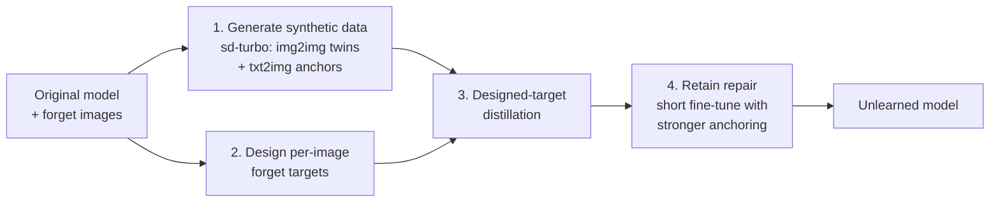

# Designed-Target Distillation for Machine Unlearning

Our solution to the **Unlearning** task of the European AI Championship (Paris 2026).

We start from a ViT-B/16 classifier trained on a 100-class dataset. The goal is to make it behave **as if it had never seen 3,500 specific training images**, while leaving its behaviour on everything else unchanged.

Our method has two ingredients:

1. **Designed-Target Distillation.** For every forget image, we write down the output we want the model to produce. Then we distil the model toward these targets.
2. **Synthetic anchors from a diffusion model.** We generate new in-distribution images with a diffusion model. These images keep the rest of the model's behaviour intact while it forgets, even though no retain data was provided.

**Result:** 0.400 on the public leaderboard. A model that has not unlearned anything scores 0.

---

## The problem in one paragraph

The scoring does not reward simply destroying accuracy on the forget images. It compares the model with a **"gold" reference**: the average of several models retrained from scratch without those images. A good submission must match gold:

- in its **loss distribution** on the forget images (mean and spread),
- in its **predicted class distribution, image by image**, including which wrong classes it leans toward,
- on the exact images **and** on hidden altered copies of them.

At the same time, the model's outputs on a hidden control set must stay close to the original model's. Even small drift is penalised. We receive no retain data, only the original model and the 3,500 forget images (without labels).

## Motivation

### 1. Unlearning means producing a specific behaviour, not causing damage

A retrained model has never seen a forget image, so it treats it like any new image. On most of them it is moderately unsure. On a minority it is confidently wrong. When it errs, it picks classes that are visually close.

Gradient ascent and similar methods only push the true-class probability down. The result does not look like a model that never saw the data.

So we flip the problem around. **We first decide what the unlearned model should output on each forget image, and then train the model to produce exactly that.** The training objective becomes plain distillation toward known targets, which is stable, controllable and easy to monitor.

### 2. We can generate new images from the same distribution

Looking at the forget set, we noticed that **the images are themselves diffusion-generated**: a consistent cinematic style, shallow depth of field and warm lighting. This means an off-the-shelf diffusion model ([`stabilityai/sd-turbo`](https://huggingface.co/stabilityai/sd-turbo)) can produce **new images from essentially the same distribution**. The original model has never trained on these images.

This addresses the hardest constraint of the task, the lack of any retain data:

| Synthetic data | How it is made | Why we need it |
|---|---|---|
| **Image-to-image "twins"** | Each forget image is lightly re-generated: same object, same style, new pixels | They show how the original model behaves on a near-copy it has *not* memorised. They also anchor the model in the neighbourhood of the forget set, where forgetting is most likely to leak. |
| **Text-to-image anchors** (~20k images) | Generated from a broad vocabulary of objects and scenes (~300 nouns × 6 style prompts) in the dataset's style | The forget set covers only 45 of the 100 classes, but the control set covers all 100. These images give us a stand-in retain set that reaches every class, labelled with the original model's own soft predictions. |

During training we keep the model's outputs on these images close to the original model's (knowledge distillation at temperature 2). In practice this keeps the model unchanged everywhere except on what it must forget.

---

## Method



### Step 1: Generate synthetic data

- **Twins:** sd-turbo image-to-image on every forget image, at several noise strengths. The strength sets how far each twin drifts from its source.
- **Text-to-image anchors:** about 20k images from about 300 object and scene prompts combined with "cinematic photograph" style prompts.
- We run the original model on all generated images and store its logits. These logits are the teacher signal for the retain loss.

### Step 2: Design the forget targets

The forget set has no labels, so we use the original model's prediction as the label. The model has memorised these images, so its prediction is the training label.

For each forget image *i* we build a target distribution (at temperature 2):

```
q_i = [ t_i on the true class ,  (1 − t_i) spread over the other classes ]
```

- **How mass is spread over wrong classes.** We follow the original model's own ranking of the wrong classes (its "dark knowledge"), slightly sharpened. The model then errs toward visually similar classes, as a retrained model would.
- **True-class probability `t_i`.** We optimise it jointly over all images so that the resulting cross-entropy losses follow the distribution we expect from a retrained model:
  - a **heavy-tailed** loss distribution (mean ≈ 5, standard deviation ≈ 7),
  - most images moderately uncertain, a minority confidently misclassified,
  - an average true-class probability around 0.3.
- **Which images get the heavy tail.** We assign this at random. The gold reference averages several independently retrained models, and each of them is wrong on *different* images. So no individual image should be singled out as "the one to forget hardest".

### Step 3: Designed-target distillation

We fine-tune transformer blocks 4–11 and the classification head. Blocks 0–3 and the patch embedding stay frozen. The objective has a **forget** part and a **retain** part.

**Forget (clean and augmented views of each forget image):**
- a KL loss toward the designed distribution `q_i` at temperature 2, and
- a Huber loss on the logit margin, so that each image reaches its designed loss value.

**Retain:**
- KL(original ‖ model) at temperature 2 on a mixed batch of anchors: text-to-image images, image-to-image twins, a few generic outside images, and mixups of forget images.

Settings: 30 epochs, learning rate 2e-4, retain weight 5.

### Step 4: Retain repair

The model already forgets well after Step 3, but it has drifted somewhat from the original on unrelated images. Since drift is penalised in every scored image, **reducing it is the biggest remaining lever**. We therefore run a short second fine-tune from the Step 3 checkpoint. It keeps the same forget targets, and tightens the anchoring:

- a **stronger retain weight** (10) and a larger share of text-to-image anchors (35%),
- **twins closer to the forget images**, plus generated images on which the original model is as confident as on its training data (these behave like the hidden control set),
- **augmented forget views keep their designed loss.** Their target mixes in the original model's prediction on an equally augmented twin, so the model also behaves like gold on altered copies.

Settings: 10 epochs, learning rate 1e-4.

Our final submission is a uniform weight average of two runs of this recipe. This brings a marginal, within-noise gain.

---

## Results (public leaderboard)

| Stage | Score |
|---|---|
| Original model (no unlearning) | 0.000 |
| Designed-target distillation (Steps 2–3, no text-to-image anchors) | 0.385 |
| + text-to-image anchors from the start | 0.397 |
| + retain repair (Step 4) | 0.400 |
| Weight average of two repaired runs (**submitted**) | 0.400 |

Run-to-run noise on the public split is about ±0.005, so the last row only confirms the recipe is stable.

## Key takeaways

- **Define the target behaviour explicitly.** Treat unlearning as distillation toward designed targets, not as gradient ascent. This gives direct control over both the loss distribution and the per-image predictions.
- **Retain drift is the dominant cost.** Every gain in forgetting must be paid for with as little drift as possible. Most of our late improvements came from better anchoring, not from better forget targets.
- **Diffusion models can stand in for missing data.** When the training data is itself synthetic, a generative model can produce in-distribution images the original model has never seen. These images serve both as unseen look-alikes of the forget set and as a retain set covering every class.
- **Keep updates smooth.** Plain full fine-tuning with distillation behaved far better on the hidden evaluation than sharp, localised weight edits.

---

## Repository layout

```
task_template.py          model builder + server preprocessing (provided)
submission.py             submission client (provided)
scripts/
  common.py               shared loading / evaluation utilities
  gen_twins.py            Step 1: img2img twins of the forget images (sd-turbo)
  gen_t2i.py              Step 1: txt2img retain anchors (sd-turbo)
  design_targets.py       Step 2: per-image designed forget targets
  dz.py                   Step 3: designed-target distillation (base)
  dzt.py                  Step 3: + text-to-image anchors
  dzmt.py                 Step 4: retain repair
  soupN.py                weight averaging of checkpoints
```

## Reproducing

Requirements: PyTorch, timm, numpy, and `diffusers` + `transformers` for the generation step. We ran everything on single A100 GPUs.

```bash
# 1. Synthetic data (each script shards across GPUs with --shard i --nshards N)
python scripts/gen_twins.py --strengths 0.5,0.3,0.7
python scripts/gen_twins.py --strengths 0.875,0.625 --steps 8
python scripts/gen_t2i.py --n 20000

# 2. Designed targets
python scripts/design_targets.py --hyp tail --tailP 0.3 --tail_tau 0.75 \
    --mu 5 --sd 7 --init_noise 0.5 --name u_tt0.75_m5s7

# 3. Designed-target distillation with text-to-image anchors
python scripts/dzt.py --run base --target output/targets/dz_u_tt0.75_m5s7.pt \
    --train_from_block 4 --mg_w 1 --alpha 5 --epochs 30 \
    --outside_frac 0.25 --twin_frac 0.25 --t2i_frac 0.3

# 4. Retain repair
python scripts/dzmt.py --run repair --init output/base/ckpt_01620.pt \
    --target output/targets/dz_u_tt0.75_m5s7.pt \
    --lr 1e-4 --epochs 10 --train_from_block 4 --warmup 10 --alpha 10 \
    --mg_w 2 --aug_mix 0.5 --mg_aug_w 2.0 --aug_shift 0.5 \
    --twins2 'output/twins/s0.625_sh*.npz,output/twins/s0.7_sh*.npz' \
    --mem_frac 0.25 --outside_frac 0.05 --twin_frac 0.05 --twin2_frac 0.2 --t2i_frac 0.35
```

The final checkpoint is a standard `timm` `vit_base_patch16_224` state dict (float32). It loads with `strict=True` into the architecture from `task_template.py`.

## References

- Kurmanji et al., *Towards Unbounded Machine Unlearning* (SCRUB), NeurIPS 2023
- Chundawat et al., *Zero-Shot Machine Unlearning*, IEEE TIFS 2023
- Hinton et al., *Distilling the Knowledge in a Neural Network*, 2015
- Sauer et al., *Adversarial Diffusion Distillation* (SD-Turbo), 2023
